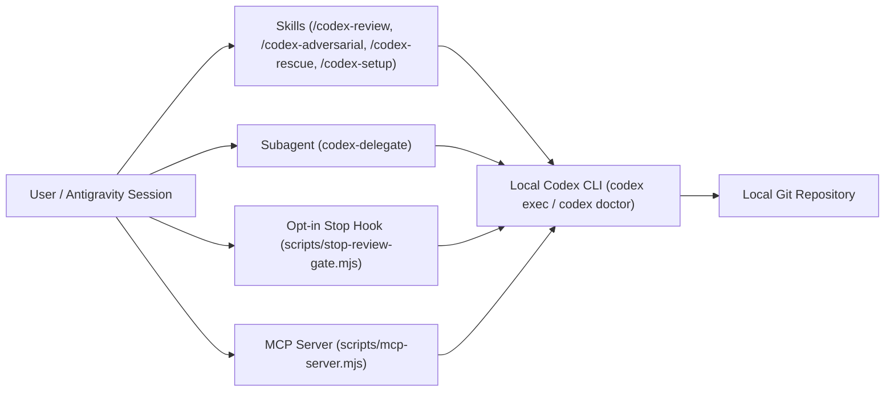

# agy-codex-plugin

A minimal, zero-broker **Antigravity (`agy`)** plugin for delegating code reviews, adversarial audits, and debugging or implementation tasks to your local OpenAI **Codex CLI** (`codex`).

## Why This Architecture (Zero-Broker Design)

Instead of shipping a custom background daemon, a JSON-RPC app-server client, or a duplicate job tracker, `agy-codex-plugin` pairs **Codex's stable non-interactive CLI** (`codex exec -s read-only review`, `codex exec`, `codex doctor`) with **Antigravity's native primitives**:

- **Skills (`/<skill-name>`)** expose `/codex-review`, `/codex-adversarial`, `/codex-rescue`, and `/codex-setup` with zero wrapper code.
- **Reactive `run_command` background wakeup** lets long-running `codex` runs execute asynchronously and wake Antigravity up when finished—no `/status`, `/result`, or `/cancel` polling needed.
- **Custom subagent (`codex-delegate`)** lets Antigravity delegate second opinions or isolated Codex runs in the background.
- **Native `Stop` hook (`hooks.json`)** optionally checks uncommitted changes before Antigravity finishes a turn, using `continuationActive` to prevent loops and failing open on errors.
- **Bundled stdio MCP server (`mcp_config.json`)** exposes Codex review, exec, resume, and diagnostics as typed tools with zero npm dependencies.



## Repository Layout

```text
agy-codex-plugin/
├── plugin.json                        # Antigravity plugin manifest (name: codex-cli)
├── mcp_config.json                    # Bundled Codex MCP server registration
├── README.md
├── LICENSE                            # MIT
├── assets/
│   └── logo.svg                       # 128x128 plugin icon
├── skills/
│   ├── codex-review/SKILL.md          # /codex-review (read-only code review)
│   ├── codex-adversarial/SKILL.md     # /codex-adversarial (skeptical challenge review)
│   ├── codex-rescue/SKILL.md          # /codex-rescue (delegated codex exec + resume --last)
│   └── codex-setup/SKILL.md           # /codex-setup (install & codex doctor check)
├── agents/
│   └── codex-delegate.md              # Background subagent wrapper around codex CLI
├── hooks.json                         # Opt-in Stop review gate (disabled by default)
├── scripts/
│   ├── mcp-server.mjs                 # Zero-dependency Node ESM stdio MCP server
│   ├── stop-review-gate.mjs           # Zero-dependency Node ESM Stop hook
│   └── codex-command.mjs              # Shared subprocess launch and cleanup
└── tests/
    ├── mcp-server.test.mjs            # MCP protocol and Codex invocation tests
    └── stop-review-gate.test.mjs      # Stop hook tests
```

## Prerequisites

1. **OpenAI Codex CLI** (`codex`) installed and authenticated:
   ```bash
   # Install (choose one)
   brew install --cask codex
   # or
   npm install -g @openai/codex

   # Authenticate (ChatGPT subscription or OPENAI_API_KEY)
   codex login
   ```
2. **Antigravity** (`agy` CLI, Antigravity App, or Antigravity IDE).
3. **Node.js** on `PATH` for the bundled MCP server and the optional `Stop` hook.

## Installation

Install directly from GitHub:

```bash
agy plugin install https://github.com/whanyu1212/agy-codex-plugin
```

Or install from a local clone:

```bash
git clone https://github.com/whanyu1212/agy-codex-plugin.git
agy plugin install ./agy-codex-plugin
```

Verify the plugin is enabled, then run `/codex-setup` inside Antigravity to verify `codex doctor`:

```bash
agy plugin list
```

## Slash Commands (Skills)

| Command | Purpose | Underlying Codex CLI |
| :--- | :--- | :--- |
| `/codex-review` | Read-only review of uncommitted changes, `--base <branch>`, or `--commit <sha>` | `codex exec -s read-only review` |
| `/codex-adversarial` | Skeptical challenge review probing invariants, concurrency, edge cases, and security | `codex exec -s read-only review -` |
| `/codex-rescue` | Delegate diagnosis (`-s read-only`), fixes (`-s workspace-write`), or `resume --last` | `codex exec` |
| `/codex-setup` | Check `codex` binary, version, and authentication health | `codex doctor` |

### Examples

- `/codex-review` — review current uncommitted changes (read-only).
- `/codex-review --base main` — review your branch diff against `main`.
- `/codex-adversarial focus on auth and race conditions` — stress-test changes with a skeptical rubric piped over stdin (`<<'EOF'`). The rubric names the review target because the CLI accepts either a target flag or a custom prompt.
- `/codex-rescue diagnose why tests/auth.test.ts is flaky` — run a read-only second-opinion diagnosis.
- `/codex-rescue fix the race in src/queue.ts and run unit tests` — delegate edits inside Codex's `workspace-write` sandbox (`--worktree` when isolated changes are requested, or `codex exec resume --last` to continue prior work).

For a faster CLI run on a bounded task, you can pass `-c model_reasoning_effort=medium` after `codex exec`. For example, run `codex exec -s read-only -c model_reasoning_effort=medium review --uncommitted`.

## Subagent (`codex-delegate`)

[`agents/codex-delegate.md`](agents/codex-delegate.md) registers a lightweight `flash` background subagent (`subagent: true`, `mainAgent: false`) so Antigravity can offload a second opinion, review, or `codex exec` run without blocking your main conversation.

## MCP Tools (`mcp_config.json`)

Antigravity starts the bundled `codex` stdio server using [`mcp_config.json`](mcp_config.json). The server runs on Node.js built-ins and uses Codex from `PATH`. On Windows it prefers `codex.exe` and can also run the JavaScript entrypoint of an npm-generated `codex.cmd` shim.

| Tool | Inputs | Result |
| :--- | :--- | :--- |
| `codex_review` | Required `cwd`. Optional `target` defaults to `uncommitted`. Use `base` with `target: "base"` or `commit` with `target: "commit"`. An optional `prompt` supplies custom review instructions. | Read-only review output. |
| `codex_exec` | Required `cwd` and `prompt`. Optional `sandbox` defaults to `read-only` and also accepts `workspace-write`. Optional `model`, `worktree`, and `ephemeral`. | JSON text with `sessionId` and `finalMessage`. |
| `codex_resume` | Required `cwd` and `prompt`. Optional `sessionId` selects a session by ID or name. Omit it to select the most recent session in `cwd`. Optional `sandbox` defaults to `read-only` and also accepts `workspace-write`. | JSON text with `sessionId` and `finalMessage`. |
| `codex_doctor` | Optional `cwd`. | Codex version and local diagnostic output. |

Review, exec, and resume accept optional `effort` values of `low`, `medium`, or `high` to override Codex's configured reasoning effort. For example, use `"effort": "medium"` for a bounded review.

All four tools accept an optional integer `timeoutMs` from 1,000 to 1,800,000 milliseconds. The default is 600,000 ms (10 minutes) for review, exec, and resume, and 60,000 ms (1 minute) for doctor. The limit covers the tool's entire command sequence, including review ref resolution and doctor fallback. On timeout the server terminates the active process tree and returns `isError: true` with the tool name and time limit.

With a custom review `prompt`, the server includes the selected target in the instructions sent to Codex. It uses Git in `cwd` to resolve a base or commit ref to a full commit SHA and returns a tool error if the ref cannot be resolved. Use either `worktree` or `ephemeral` for an exec call because Codex rejects the combination. Ephemeral sessions are available only for the duration of the call.

Codex 0.171.0 returns an error for a missing session UUID. An unknown thread name or an empty `--last` selection starts a new session. Use the returned `sessionId` to identify the session used for the turn.

### How the MCP Server Works

[`scripts/mcp-server.mjs`](scripts/mcp-server.mjs) speaks newline-delimited JSON-RPC 2.0 over `stdin`/`stdout`. It supports MCP versions `2025-06-18` and `2024-11-05` and offers `2025-06-18` when the client requests an unsupported version.

1. The server validates tool arguments, launches subprocesses with argument arrays, and passes prompts over `stdin`.
2. Reviews run through `codex exec -s read-only review`. Codex accepts a custom prompt or a target flag in a single review, so the custom prompt path uses `review -` with a `Target:` header.
3. Exec and resume parse JSONL incrementally and return `{ sessionId, finalMessage }`. Structured output without an agent message returns `finalMessage: null`. Plain stdout is used when Codex emits no JSONL events.
4. The server retains up to 1 MiB per output stream for plain output and diagnostics, skips JSONL lines over 1 MiB, and returns `[output truncated]` for an oversized final agent message. It drains inherited pipes for up to 250 ms after the subprocess exits.
5. The server answers `ping` while a tool runs. An MCP cancellation terminates the associated subprocess and suppresses its reply. Shutdown also cleans up active subprocesses when `stdin` closes or on `SIGINT`, `SIGTERM`, or `stdout` errors. On Unix, cleanup signals the process group and escalates to `SIGKILL` after 500 ms if needed. On Windows, cleanup uses `taskkill.exe` for the process tree and falls back to terminating the direct subprocess if it is still running.

### Why MCP Over v0.1 CLI Skills (and When to Use Each)

v0.1 invoked `codex` solely through shell commands (`run_command`). Adding the MCP server in v0.2 improves reliability, safety, and token efficiency:

| Dimension | v0.1 CLI Skills (`run_command`) | v0.2 MCP Server (`mcp_config.json`) |
| :--- | :--- | :--- |
| **Permissions** | Requires approving shell commands | Reviews use `read-only`. Exec and resume default to `read-only` and accept `workspace-write` explicitly. |
| **Prompt passing** | Relies on shell heredocs (`<<'EOF'`) | Typed JSON inputs passed directly to `stdin` with zero shell-escaping bugs |
| **Context usage** | Full CLI stdout enters conversation context | Extracts the session ID and final message from JSONL |
| **Session continuity** | `codex exec resume --last` can collide across parallel tasks | Returns an explicit `sessionId` for `codex_resume` |
| **Background execution** | Native `run_command` detachment + reactive wakeup | Synchronous tool call (pair with `codex-delegate` or `/codex-*` skills for long-running background jobs) |

Use the **MCP tools** for structured, token-efficient, or permission-scoped invocations across Antigravity CLI, App, and IDE; keep using **`/codex-*` skills** when you want explicit slash-command workflows or native `run_command` background wakeup on long tasks.

## Optional Stop Review Gate (`hooks.json`)

The plugin ships with an **opt-in** `Stop` hook (`codex-stop-review-gate`) powered by [`scripts/stop-review-gate.mjs`](scripts/stop-review-gate.mjs). When enabled, it runs `codex exec -s read-only --ephemeral` on uncommitted changes before Antigravity ends a turn and continues the loop if Codex reports concrete bugs, regressions, or security issues.

To keep normal turns fast, it is **disabled by default** (`"enabled": false` in [`hooks.json`](hooks.json)) and **fails open** (`{}`) whenever:
- `continuationActive` is `true` (prevents infinite review loops)
- `terminationReason` is not `NO_TOOL_CALL`
- the workspace is not a git repo or has no uncommitted changes
- `codex` is unavailable, times out, or exits non-zero

To enable it, set `"enabled": true` in `hooks.json` inside your installed plugin directory (`~/.gemini/config/plugins/codex-cli/hooks.json`).

## Development & Testing

GitHub Actions runs both test files on Node.js 22 across Linux, macOS, and Windows on pushes to `main` and on pull requests. See the [CI workflow](.github/workflows/ci.yml).

```bash
# Run deterministic tests with a fake codex on PATH
node --test tests/stop-review-gate.test.mjs tests/mcp-server.test.mjs

# Validate the plugin, including the MCP server registration
agy plugin validate --strict .
```

## License

MIT
